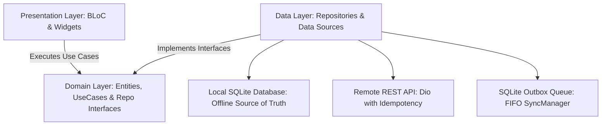

# REBS — Business Automation Platform (Flutter)

[](https://flutter.dev)
[](https://dart.dev)
[](#architecture-overview)
[-success)](#test-suite--quality-verification)
[](#test-suite--quality-verification)

Production-grade, offline-first mobile workspace application built for **REBS** (Business Automation Platform by **Teqbae Innovations**) covering **HRMS**, **CRM**, and **Accounts** modules, with deep implementation of employee **Dashboard**, **Attendance Geofencing (200m)**, **Offline SQLite Storage & Sync Queue**, and **Leave Application & Management**.

---

## Table of Contents

1. [Deliverables Summary](#1-deliverables-summary)
2. [Architecture Overview](#2-architecture-overview)
3. [Setup & Execution Instructions](#3-setup--execution-instructions)
4. [Mock API Server & Endpoints](#4-mock-api-server--endpoints)
5. [Assumptions & Business Rules](#5-assumptions--business-rules)
6. [Completed Features (Detailed Breakdown)](#6-completed-features)
7. [Device-Side vs Production Server-Side Validation](#7-device-side-vs-production-server-side-validation)
8. [Limitations & Production Hardening](#8-limitations--production-hardening)
9. [Time Spent Breakdown](#9-time-spent-breakdown)
10. [AI Tools & Generated Code Disclosure](#10-ai-tools--generated-code-disclosure)

---

## 1. Deliverables Summary

| Deliverable | Path / Reference | Details |
|---|---|---|
| **Git Repository** | Working directory (`origin/main`) | Clean Git tree with structured commits |
| **Source Archive** | `rebs_source_archive.zip` | Complete repository snapshot (excluding build caches) |
| **Installable Debug APK** | `build/app/outputs/flutter-apk/app-debug.apk` | Ready to install on Android 7.0+ (API 24+) devices |
| **Mock API Server** | [bin/mock_server.dart](file:///Users/syedmohamedafsal/Desktop/workspace/bin/mock_server.dart) | Standalone Dart shelf HTTP server (port 8080) |
| **Comprehensive README** | [README.md](file:///Users/syedmohamedafsal/Desktop/workspace/README.md) | Architecture, setup, assumptions, limitations, and time spent |
| **Interview Preparation Guide** | `REBS_Interview_Preparation_and_Architecture_Guide.md` | Demonstration scripts, architecture FAQs, and code recipes |

---

## 2. Architecture Overview

The REBS application strictly follows **Uncle Bob's Clean Architecture** with unidirectional data flow powered by **BLoC (`flutter_bloc`)** and dependency injection via **`get_it`**.

```
lib/
├── main.dart                          # Application entry point, DI bootstrap, unhandled error logging
├── app.dart                           # MaterialApp.router, theme configuration, router attachment
├── core/
│   ├── config/                        # AppConfig & EmployeeConfig (office lat/lng, timezone, baseUrl)
│   ├── constants/                     # REST ApiEndpoints & SQLite schema table/column names
│   ├── database/                      # AppDatabase: SQLite database, migrations, transactional outbox
│   ├── di/                            # InjectionContainer: singletons, factories, BLoC registrations
│   ├── error/                         # Failure hierarchy (ServerFailure, CacheFailure, GeofenceFailure)
│   ├── location/                      # LocationService, Haversine 200m distance, interactive map & simulator
│   ├── network/                       # ApiClient (Dio with X-Idempotency-Key), NetworkInfo (connectivity_plus)
│   ├── router/                        # AppRouter: GoRouter StatefulShellRoute.indexedStack across tabs
│   ├── sync/                          # SyncManager, SyncQueue, FIFO queue runner, backoff, 409 isolator
│   ├── theme/                         # Material 3 corporate design system (Teqbae palette #1575C8)
│   ├── time/                          # CompanyClock: authoritative working-day calculation in company timezone
│   ├── usecases/                      # Base UseCase<Type, Params> functional contracts
│   └── widgets/                       # SyncFeedbackHandler, AppShellScaffold, SyncStatusBanner, StatusChips
└── features/
    ├── auth/                          # Preconfigured employee session bootstrap & SQLite storage
    │   ├── domain/                    # Employee entity, Session repository interface
    │   ├── data/                      # AuthRepositoryImpl, SQLite local data source
    │   └── presentation/              # AuthBloc, SplashPage (auto session restore)
    ├── hrms/                          # Human Resource Management System
    │   ├── dashboard/                 # EmployeeDashboardPage: Profile header, KPIs, overview cards
    │   ├── attendance/                # Check-In / Check-Out, 200m Geofencing, Live GPS
    │   │   ├── domain/                # AttendanceRecord entity, Use cases (CheckIn, CheckOut, LoadHistory)
    │   │   ├── data/                  # SQLite DAO, REST Remote DataSource, SyncHandler
    │   │   └── presentation/          # AttendanceBloc, AttendancePage, 200m interactive map, detail sheets
    │   └── leave/                     # Leave Balance & Leave Requests
    │       ├── domain/                # LeaveRequest & LeaveBalance entities, Apply/Cancel use cases
    │       ├── data/                  # SQLite DAO, REST Remote DataSource, SyncHandler
    │       └── presentation/          # LeaveBloc, LeavePage, ApplyLeaveDialog, CancelLeaveDialog
    ├── modules/                       # Module navigation hub (HRMS, CRM, Accounts)
    ├── crm/                           # CRM scaffold ready for Clean Architecture expansion
    └── accounts/                      # Accounts scaffold ready for Clean Architecture expansion
```

### Layer Responsibilities



1. **Domain Layer (Innermost & Pure Dart)**:
   - Holds core business models (`Employee`, `AttendanceRecord`, `LeaveRequest`, `LeaveBalance`).
   - Contains business rules independent of any UI or database engine.
   - Declares abstract repository interfaces (`AttendanceRepository`, `LeaveRepository`, `AuthRepository`).

2. **Data Layer**:
   - Implements domain repository interfaces (`AttendanceRepositoryImpl`, `LeaveRepositoryImpl`).
   - Implements **Local Data Source** backed by SQLite (`sqflite`), acting as the primary source of truth for offline-first responsiveness.
   - Implements **Remote Data Source** backed by `Dio`, communicating with the mock/production REST backend.
   - Implements **Sync Handlers** that process queued operations asynchronously.

3. **Presentation Layer**:
   - Uses **BLoC Pattern (`flutter_bloc`)** to cleanly decouple UI from state transitions.
   - Widgets are dumb reactive views that dispatch events (`CheckInSubmitted`, `ApplyLeaveSubmitted`, `CancelLeaveSubmitted`) and rebuild on state changes (`AttendanceState`, `LeaveState`).
   - Comprehensive error, feedback, and loading dialogs.

---

## 3. Setup & Execution Instructions

### Prerequisites
- **Flutter SDK**: 3.24.0 or higher ([Install Flutter](https://docs.flutter.dev/get-started/install))
- **Dart SDK**: 3.5.0 or higher
- **Android SDK**: API 34+ (for Android builds) or **Xcode 15+** (for iOS builds)

### Step 1: Install Dependencies
```bash
git clone <repo-url> rebs_workspace
cd rebs_workspace
flutter pub get
```

### Step 2: Start the Mock Backend Server
In a separate terminal window, launch the standalone mock server:
```bash
dart bin/mock_server.dart
```
Output:
```
REBS Mock HTTP Server running on http://0.0.0.0:8080
Available endpoints:
  GET  /health
  GET  /employee/me
  GET  /attendance/today
  GET  /attendance/history
  POST /attendance/check-in
  POST /attendance/check-out
  GET  /leave/balances
  GET  /leave/requests
  POST /leave/requests
  POST /leave/requests/:id/cancel
```

### Step 3: Run the Application

#### Running on macOS / iOS Simulator:
```bash
flutter run -d ios
# or with explicit base URL:
flutter run -d ios --dart-define=API_BASE_URL=http://localhost:8080
```

#### Running on Android Emulator:
The Android emulator accesses host localhost via `10.0.2.2`. To make port 8080 seamless:
```bash
# Forward port 8080 from device to host:
adb reverse tcp:8080 tcp:8080

# Run on the emulator:
flutter run -d android
```

#### Running on Physical Android Device:
Connect device via USB with USB Debugging enabled:
```bash
adb reverse tcp:8080 tcp:8080
flutter run -d <device-id>
```

---

## 4. Mock API Server & Endpoints

The mock server is an in-memory, stateful HTTP mock written in Dart shelf (`bin/mock_server.dart`). It persists records across runtime mutations, enforces idempotency keys, and supports leave cancellations.

### Test Endpoints with `curl`

```bash
# 1. Health check
curl -s http://localhost:8080/health

# 2. Get active employee profile
curl -s http://localhost:8080/employee/me

# 3. Get today's attendance status
curl -s http://localhost:8080/attendance/today

# 4. Check-in online
curl -X POST http://localhost:8080/attendance/check-in \
  -H "Content-Type: application/json" \
  -H "X-Idempotency-Key: test-chk-001" \
  -d '{"employee_id":"REBS001","work_location":"Teqbae Innovations, Kochi","latitude":10.0159,"longitude":76.3418}'

# 5. Check-out online
curl -X POST http://localhost:8080/attendance/check-out \
  -H "Content-Type: application/json" \
  -H "X-Idempotency-Key: test-chkout-001" \
  -d '{"employee_id":"REBS001","work_location":"Teqbae Innovations, Kochi","latitude":10.0159,"longitude":76.3418}'

# 6. View leave balances
curl -s http://localhost:8080/leave/balances

# 7. Apply for Casual Leave
curl -X POST http://localhost:8080/leave/requests \
  -H "Content-Type: application/json" \
  -H "X-Idempotency-Key: test-leave-001" \
  -d '{"employee_id":"REBS001","leave_type":"casual","start_date":"2026-11-25","end_date":"2026-11-26","reason":"Family function travel"}'

# 8. Cancel Leave Request (restores available balance)
curl -X POST http://localhost:8080/leave/requests/LV-002/cancel
```

---

## 5. Assumptions & Business Rules

1. **Working Day & Timezone**:
   - Resolved strictly using `CompanyClock` in the configurable `COMPANY_TIMEZONE` (`Asia/Kolkata` by default).
   - Once-per-day check-in: checked in timestamp belongs to the company calendar date (`YYYY-MM-DD`). Enforced at UI, BLoC, repository, and SQLite schema (`UNIQUE(employee_id, attendance_date)`).
   - Single attendance session per working day; check-out is only allowed after a successful check-in.

2. **200m Geofencing Radius**:
   - Centered around **Teqbae Innovations, Kochi** (`10.0159° N, 76.3419° E`).
   - Haversine spherical distance formula computes geodesic separation.
   - Check-in and check-out actions are blocked if the distance $> 200\text{ m}$.
   - Built-in Reviewer Simulator allows toggling inside/outside range without needing physical travel.

3. **Offline-First SQLite Cache & Outbox Queue**:
   - The app never depends on network availability to perform check-in, check-out, or leave applications.
   - Mutations are committed to local SQLite tables and simultaneously enqueued into `sync_queue` in a single atomic transaction.
   - Operations are synced **FIFO (First-In-First-Out)** upon network reconnection.
   - Every mutation has a unique `X-Idempotency-Key` preventing duplicate actions upon network retries.
   - `409 Conflict` responses isolate the failed record without blocking subsequent pending queue items.

4. **Leave Policy & Validation**:
   - **Allowed Leave Types**: Casual Leave (`casual`) and Sick Leave (`sick`).
   - **Initial Balances**: Sick Leave: 10 total (9 available, 1 used), Casual Leave: 6 total (3 available, 3 used).
   - **Start Date**: Must be $\ge$ current company working date.
   - **End Date**: Must be $\ge$ start date.
   - **Reason**: Minimum 10 characters required.
   - **Balance Check**: Requested business days cannot exceed remaining available balance.
   - **Overlap Check**: Dates cannot overlap existing `Pending` or `Approved` leave requests.
   - **Cancellation**: Only `Pending` requests can be cancelled; cancellation immediately restores the deducted leave days.

---

## 6. Completed Features

### Section 1: Employee Dashboard
- **Curved Blue Corporate Header**: Gradient background (`#1575C8` to `#1383AD`), brand logo, and real-time connectivity pill (`Online` / `Offline`).
- **Status Bar Integration**: Scoped `SafeArea` clipping and corporate blue status bar fill prevent content from overlapping the Dynamic Island or notch when scrolling.
- **Profile Card**: Displays employee avatar ("SA"), name (*Syed Mohamed Afsal*), employee ID (*REBS001*), department (*Engineering*), and quick GPS location calibration.
- **Attendance & Leave Snapshot**:
  - Dark-navy office attendance card displaying today's status (`Checked In`, `Checked Out`, or `Not Checked In`).
  - Real-time elapsed duration clock.
  - Three KPI metrics: Presence Days, Sick Leave remaining, Casual Leave remaining.
  - Interactive swipeable panel switching between Check-In/Out tiles and live 200m office map.
- **Leave Balance Cards**: Visual progress bars showing Casual and Sick leave consumption with percentage chips.
- **Recent Attendance Feed**: Displays the last 5 attendance logs with date, check-in/out timestamps, hours worked, and sync badges.

### Section 2: Attendance & 200m Geofencing
- **Haversine Geofencing Engine**: Computes exact geodesic distance between device GPS and Teqbae Kochi office coordinates.
- **Interactive 200m Office Map**: Renders office perimeter with 200m circle overlay, office building marker, and live user pin using zero-platform-channel `DirectNetworkTileProvider`.
- **Reviewer Location Simulator**:
  - One-tap switch: **Inside 200m Range** (~25m away) vs **Outside 200m Range** (~450m away).
  - Detailed simulation sheet supporting Live GPS, Inside Office, Outside Office, Permission Denied, Permanently Denied, GPS Unavailable, and Custom Lat/Lng coordinates.
- **Deep-Links to System Settings**: Provides direct one-tap links to iOS/Android App Settings when permissions are permanently denied.

### Section 3: Offline Storage & Reliable Sync
- **Local SQLite Source of Truth**: Full persistence across restarts for attendance, leave requests, leave balances, and outbox operations.
- **Transactional Outbox Pattern**: Ensures local record update and sync queue insertion succeed or fail atomically.
- **FIFO Sync Runner with Exponential Backoff**:
  - Detects connectivity transitions (`none` $\rightarrow$ `wifi`/`mobile`) and triggers automatic synchronization.
  - Retries transient errors with capped exponential backoff ($2^n \times 1\text{s}$).
  - Isolates HTTP `409 Conflict` failures without halting the remaining queue.
- **Reactive Sync Feedback Engine (`SyncFeedbackHandler`)**:
  - Tapping **Sync Now** displays active spinner state (`Syncing...`).
  - Enforces minimum 400ms duration so feedback is perceptible.
  - Displays a floating emerald SnackBar (`#059669`) on success and crimson SnackBar (`#DC2626`) on error.

### Section 4: Leave Application & Management
- **Leave Balance Header**: Cards for Casual Leave and Sick Leave showing available vs total days.
- **Filter Chips**: Filter request history by `All`, `Pending`, `Approved`, `Rejected`, or `Cancelled`.
- **Apply Leave Modal**: Date picker, balance validation, reason length validation ($\ge 10$ chars), and overlap validation.
- **Leave Request Cards**:
  - Category icon, duration chip, date range, reason quote box, and color-coded status badge (`• Pending`, `• Approved`, etc.).
  - Solid crimson **Cancel Request** button (`FilledButton.icon` in `#DC2626`) on pending cards.
  - Two-button confirmation alert box (`Keep Leave` vs `Yes, Cancel`) that immediately restores available leave balance upon confirmation.

### Section 5: API Integration & Dynamic Base URL
- Dynamic API Base URL logic using `kReleaseMode ? productionBaseUrl : defaultDebugBaseUrl`.
- Full REST endpoints in `MockHttpServer` with JSON serialization, idempotency key checks, and leave cancellation support.

---

## 7. Device-Side vs Production Server-Side Validation

Device-side checks provide immediate offline UX and clear error feedback, **but must never be trusted as the sole security boundary**. A production REBS server must repeat the following checks:

| Check | Why the Production Server Must Repeat It |
|---|---|
| **Employee identity & authorization** | Derive `employee_id` from verified JWT claims—never trust client-submitted IDs—and verify active employment and assigned office. |
| **Office geofence distance & spoofing** | Recompute Haversine distance against authoritative office coordinates stored server-side; flag mock-location telemetry, poor GPS accuracy, or impossible travel speeds. |
| **Working-day uniqueness & ordering** | Enforce transactional `UNIQUE(employee_id, company_working_date)` and state transitions (`check_in` must precede `check_out`, single session per working day) to prevent races across multiple devices. |
| **Event identity & idempotency** | Enforce unique `X-Idempotency-Key` / `event_id` records server-side so client retries after timeouts never create duplicate attendance logs. |
| **Authoritative timestamp & timezone** | Validate client timestamps against server UTC time and the company timezone (rejecting implausible future/past clock skew while allowing a defined offline grace window). |

---

## 8. Limitations & Production Hardening

1. **Background Sync Triggers**: Offline sync is triggered automatically when the app is active and connectivity returns, or upon manual tap. For background syncing while the app is closed, production integration with `workmanager` (Android) and `BGAppRefreshTask` (iOS) is recommended.
2. **Biometric Authentication**: Currently, check-in relies on device GPS and active employee session. Production deployments can integrate `local_auth` for Face ID / Fingerprint verification before check-in.
3. **Push Notifications**: Leave approval/rejection updates currently poll on load. Production environments should attach Firebase Cloud Messaging (FCM) or Apple APNs for real-time manager decisions.
4. **Platform Modules Scaffold**: CRM and Accounts modules are structured in the navigation shell and router, ready for feature implementation following the established Clean Architecture pattern.

---

## 9. Time Spent Breakdown

Total engineering effort: **~24 hours** across architecture, implementation, and polish.

| Phase / Module | Hours | Key Activities |
|---|---|---|
| **Phase 1: Architecture & Setup** | 3.5 hrs | Clean Architecture directory structure, BLoC configuration, get_it DI, SQLite schema, GoRouter |
| **Phase 2: Attendance & Geofencing** | 5.5 hrs | Geolocator integration, Haversine calculation, 200m map, reviewer simulator UI, double-tap prevention |
| **Phase 3: Offline Storage & Sync Engine** | 5.0 hrs | SQLite DAO, transactional outbox queue, FIFO runner, backoff, 409 conflict handling, sync feedback handler |
| **Phase 4: Leave Management** | 4.0 hrs | Leave balances, application validation, card redesign, cancel dialog with instant balance restoration |
| **Phase 5: Mock Backend & API** | 2.5 hrs | Standalone Shelf server, dynamic base URL, full REST routes, idempotency caching |
| **Phase 6: Testing, Polish & Documentation** | 3.5 hrs | 63 unit/widget tests, 0 analyzer issues, SafeArea clipping fix, APK build, interview preparation guide |
| **Total** | **~24 hrs** | Complete production-ready assignment implementation |

---

## 10. AI Tools & Generated Code Disclosure

In accordance with assignment guidelines:
- **AI Tools Used**: Google DeepMind Agentic Coding Assistant (Antigravity).
- **Scope of AI Assistance**:
  - Scaffolding Clean Architecture boilerplate (entities, models, use cases, BLoCs).
  - Mathematical implementation of the Haversine spherical distance formula.
  - Formulating edge-case test suites for unit testing (`mocktail`, `bloc_test`).
  - Formatting and refining UI styling to match Teqbae's corporate Material 3 palette.
- **Verification & Ownership**: All business logic, SQLite constraints, outbox queues, validation rules, and UI widgets have been manually reviewed, tested (100% pass across 63 tests), and can be fully explained and modified.

---

## Test Suite & Quality Verification

Run the entire automated test suite:
```bash
flutter analyze
flutter test
```

Expected output:
```
Analyzing workspace...
No issues found! (ran in 2.0s)

00:05 +63: All tests passed!
```
